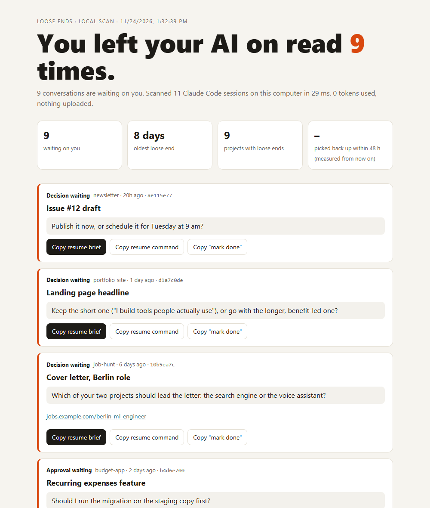

# Loose Ends

**You left your AI on read.**



Loose Ends finds the Claude Code conversations that are waiting on *you*: a question you never answered, a plan you never approved, an error you left, a step Claude handed to you. It tells you once when a session starts, and gives you a short resume brief so you can pick each one back up in seconds.

- **100% local.** It reads the session files Claude Code already keeps on your computer (`~/.claude/projects`). Nothing is uploaded, and there are no network calls.
- **0 tokens to scan.** Detection is plain rules, not a model. A full scan of 150 sessions (1.8 GB) takes ~3 s the first time and ~50 ms after that (it only re-reads sessions that changed).
- **Cheap to resume.** A resume brief is ~150-400 tokens, much less than scrolling back into a 100k-token thread.

## Install (Claude Code)

```
/plugin marketplace add KhalilBenGaied66/loose-ends
/plugin install loose-ends@loose-ends
```

The second command opens the plugin's page instead of installing straight away. On that page, choose **Install for you (user scope)** and press Enter. Then start a new session, or run `/reload-plugins`.

Other ways to install:

- **From a terminal, with no menus:** `claude plugin marketplace add KhalilBenGaied66/loose-ends`, then `claude plugin install loose-ends@loose-ends`. It loads the next time you start Claude Code.
- **Claude desktop app (Code tab):** its plugin browser (**+** > **Add plugins**) lists only marketplaces that were already added, and it has no box for adding a GitHub one. Add it once with the terminal commands above, then restart the app. If `claude` isn't a command in your terminal, paste this into a Code tab session instead: *"Install the Claude Code plugin Loose Ends for me: run `claude plugin marketplace add KhalilBenGaied66/loose-ends`, then `claude plugin install loose-ends@loose-ends`. If `claude` isn't on my PATH, use the Claude Code executable this app runs. Show me the output of both."*

Requires Node.js 18+ on your PATH. Without it, the plugin tells you once what to install and otherwise stays silent: it never shows hook errors.

Want to see it before it reads anything of yours? `node plugins/loose-ends/scripts/loose-ends.mjs demo page` builds made-up sessions in a temp folder and opens the scan page for them (that's the screenshot above).

## Use

| In Claude Code | What it does |
|---|---|
| (automatic) | At session start, one line: *"Loose Ends: 4 conversations are waiting on you (1 in this project)."* Shown again only after 3 hours or when the count changes. |
| `/loose-ends:scan` | The numbered list, each with its status. In the Claude desktop app, click a title to open that session. Then reply `brief 1`, `done 2 3` or `snooze 1 7d`. `--all` also shows optional "want me to also…?" offers. |
| `/loose-ends:brief <number or id>` | A link to open the session (desktop app), where it stopped, what's waiting on you, the links you shared, and the `claude --resume` command. |
| `/loose-ends:page` | Opens a local scan page in your browser with copy buttons. |

The same tool works from any terminal, with 0 tokens:

```
node plugins/loose-ends/scripts/loose-ends.mjs            # list
node plugins/loose-ends/scripts/loose-ends.mjs brief 41972fa0
node plugins/loose-ends/scripts/loose-ends.mjs done 41972fa0
node plugins/loose-ends/scripts/loose-ends.mjs snooze 41972fa0 3d   # numbers from the last list work too: done 2 3
node plugins/loose-ends/scripts/loose-ends.mjs rate 41972fa0 up     # still open / down = false alarm / handled = dealt with elsewhere
node plugins/loose-ends/scripts/loose-ends.mjs stats
```

A session you mark done comes back by itself if it gets new activity and ends waiting on you again.

## What counts as a loose end

| Label | When |
|---|---|
| Decision waiting | Claude's last words ask you to choose ("…or would you rather…?", an unanswered question box) |
| Approval waiting | Claude asks for a go-ahead ("Should I install…?", "Commit now?", "I'd want your go-ahead before…") |
| Question waiting | Any other question to you in the last few sentences |
| Your move | Claude handed you a step ("upload the zip again", "listen through once") |
| Left broken | Your last message was an error and nobody answered |
| Interrupted | You stopped Claude, a usage limit or API error cut it off, or the session died mid-task |
| No reply yet / Half done / You said later | Your message got no answer / the task list still has open steps / you wrote "I'll test it tomorrow" |

Ignored: sessions active in the last 6 hours, older than 30 days, ended with "thanks/perfect/works", questions buried mid-answer, quoted text, code, sub-agent transcripts and harness messages. Optional offers ("Want me to also add tests?") are hidden unless you pass `--all`.

## Measured

On the author's own machine (152 Claude Code sessions, 2026-11-24), the default view flagged 14 sessions. The author rated every one:

| | Count | |
|---|---|---|
| Still open, needed the author | 11 | **79 % useful reminders** |
| A real loose end, already handled in another session or outside Claude | 3 | |
| False alarm | 0 | **100 % detector precision** (14/14) |

Two caveats. **This is one user and 14 flags**, so it's a small sample. Also, recall was checked only by Claude: in a random sample of 25 sessions it did not flag, the first version missed 5 hand-offs written without a question mark. Rules were added for those, so that sample now looks clean, but the rules were tuned on that same sample, so the recall figure is optimistic. Other people's sessions will be the real test.

Known gap: all 3 "handled elsewhere" items had been finished in a *different* session (a fork, or work done outside Claude). Loose Ends only sees each session on its own for now.

The tool measures itself locally from day one: `stats` reports how many flagged loose ends you picked back up (and how many within 48 h), plus detector precision and useful-reminder rate from your ratings. Nothing is sent anywhere. Sharing those numbers is up to you.

## Privacy

In the Claude desktop app, it also reads the start of the app's own session records on your computer (`claude-code-sessions`) for three things only: the link to each session, its sidebar title, and whether you archived it. Archived sessions, and sessions you renamed with "DONE", are never flagged. Set `LOOSE_ENDS_NO_DESKTOP=1` to turn this off.

Loose Ends reads only the end (and the first megabyte) of each session file. Its own data (a cache of short summaries, your done/snooze marks and ratings) lives in `~/.loose-ends` (or `LOOSE_ENDS_HOME`). Delete that folder to reset it. Set `LOOSE_ENDS_QUIET=1` to turn off the session-start line.

## Development

```
npm test
```

Zero dependencies. Node's built-in test runner.

## License

MIT
